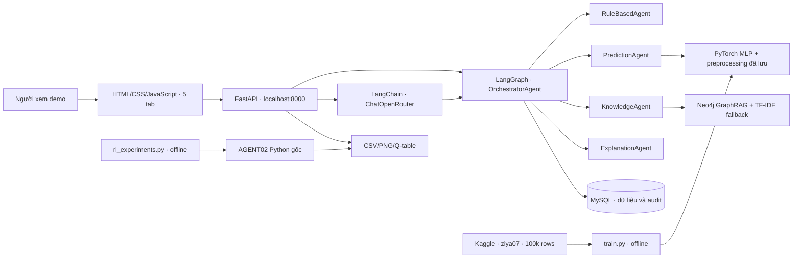
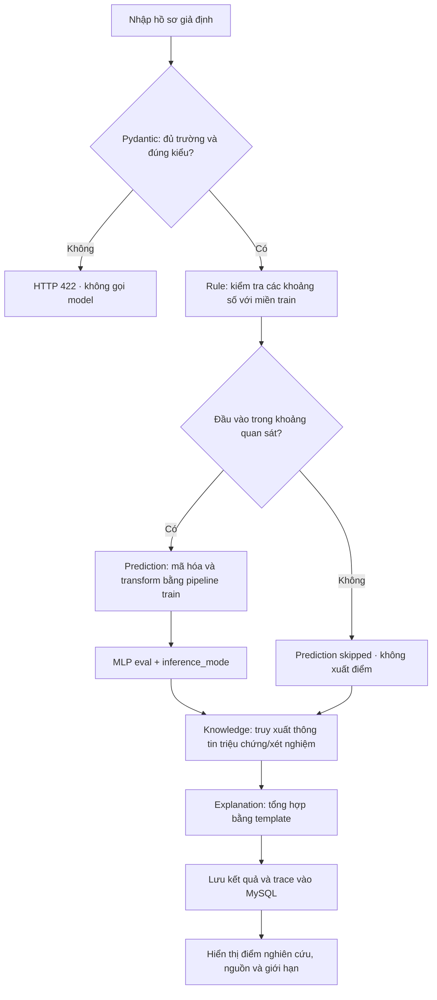
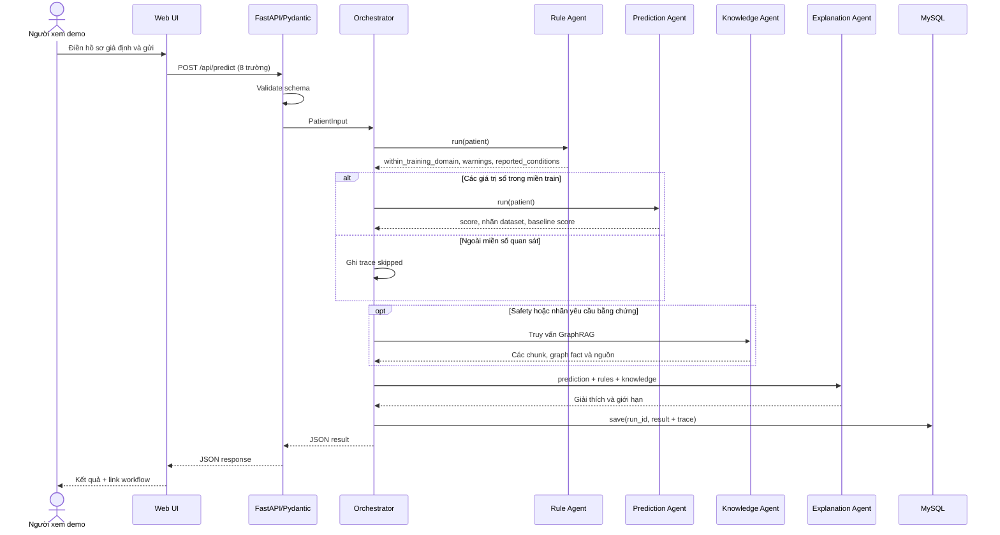

# 02. Kiến trúc và hợp đồng agent

> Cập nhật v3: luồng dự đoán chạy bằng LangGraph; tab LLM Agent dùng LangChain `ChatOpenRouter` và `StructuredTool`. Xem [hướng dẫn cấu hình](LLM_AGENT_SETUP.md).

## Kiến trúc triển khai thật

Các agent là component Python có mục tiêu và hợp đồng dữ liệu riêng. LangGraph điều phối state graph có nhánh điều kiện; LangChain cho LLM tự chọn một hoặc nhiều tool đã cho phép. Hệ thống không phải các agent phân tán hoặc tự thương lượng: quyền thực thi vẫn bị giới hạn bởi graph, schema và allowlist phía backend.

## Activity Diagram

Nếu artifact chưa có, API dự đoán trả 503 kèm lệnh train; không thay bằng số ngẫu nhiên. Yêu cầu hỏi đáp đi từ Orchestrator thẳng đến Knowledge Agent; không cần gọi model phân loại.

## Sequence Diagram

## Hợp đồng dữ liệu

| Agent | Input | Output | Tài nguyên/quyết định |
|---|---|---|---|
| Orchestrator + LangGraph | `PatientInput` hoặc câu hỏi | `run_id`, kết quả, `trace` | State graph, conditional edge và MySQL |
| RuleBased | Hồ sơ đã đúng schema | `within_training_domain`, luật khớp, cảnh báo, tiền sử nhập Có | Khoảng số đọc từ train artifact; không chẩn đoán từ tiền sử |
| Prediction | 8 trường | Điểm sigmoid MLP, nhãn diabetes=0/1, điểm logistic, giới hạn | Pipeline fit trên train + checkpoint MLP |
| Knowledge | Câu hỏi | Status, mode, evidence chứa chunk/title/url/date/score | Markdown, TF-IDF, cosine, cổng phạm vi và ngưỡng |
| Explanation | Prediction + Rules + Knowledge | Giải thích mô hình, bản tóm tắt input, thông tin chung có nguồn | Template xác định, không LLM |
| QLearning (module riêng) | `(demand, competitor_previous_action)` | Hành động giảm/không giảm giá | Q-table được học trong môi trường thương mại giả lập |

## Endpoint và lưu trữ

- `GET /`, `/assets/*`: UI; `GET /docs`: tài liệu API tự động.
- `GET /api/health`, `/api/schema`: trạng thái và hợp đồng form.
- `POST /api/predict`, `/api/ask`: hai workflow.
- `GET /api/history`, `DELETE /api/history`: lịch sử cục bộ.
- `GET /api/experiments`: đọc artifact thật; `/api/artifact/{category}/{filename}` chỉ phục vụ CSV/PNG/JSON/TXT trong danh mục cho phép.
- Docker dùng MySQL làm system of record cho execution, step, message, tool call, retrieval và prediction. SQLite `runtime/demo.sqlite3` chỉ là fallback local/test. Không có tài khoản/định danh; chỉ dùng hồ sơ giả định.

## Giới hạn của RAG có sinh

LLM có thể gọi tool GraphRAG rồi tổng hợp câu trả lời, nhưng kết quả sinh vẫn cần kiểm tra hallucination, nguồn và câu hỏi ngoài phạm vi. Endpoint `/api/ask` tiếp tục trả retrieval có cấu trúc mà không cần LLM. FAISS, Streamlit, cloud hosting và hệ thống bệnh viện không thuộc triển khai hiện tại.
