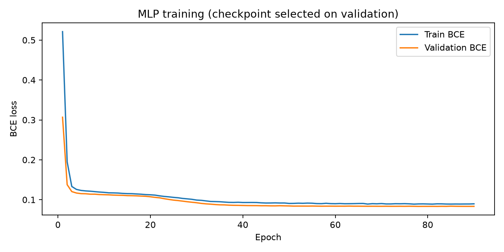
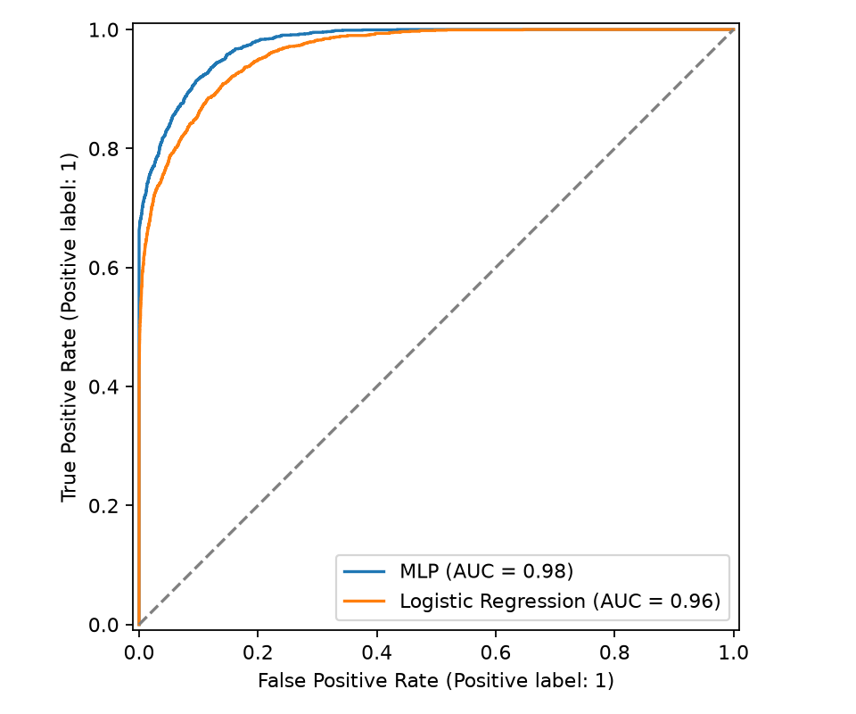
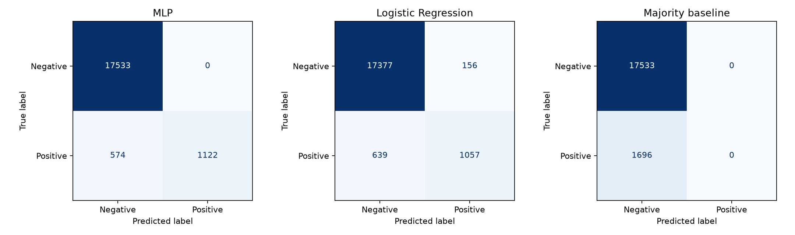
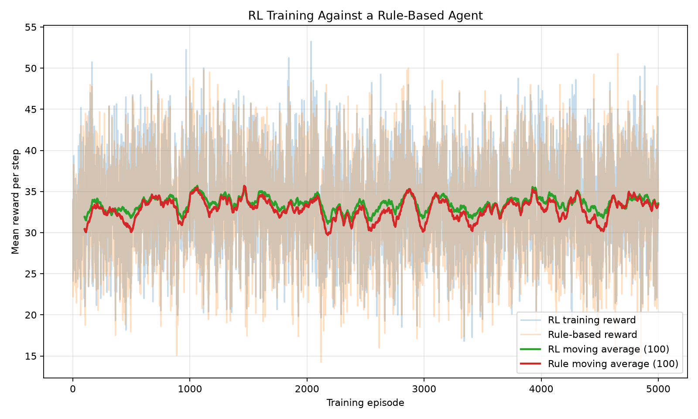
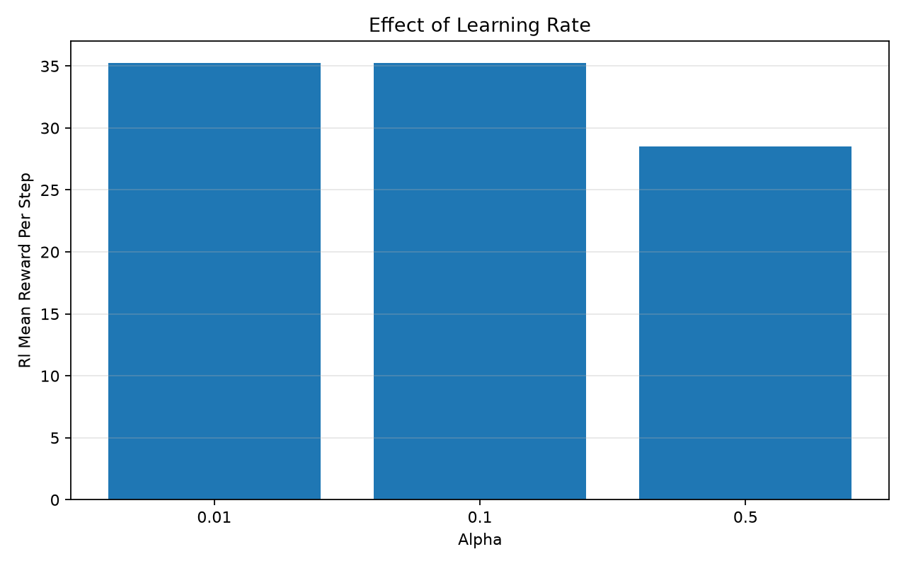
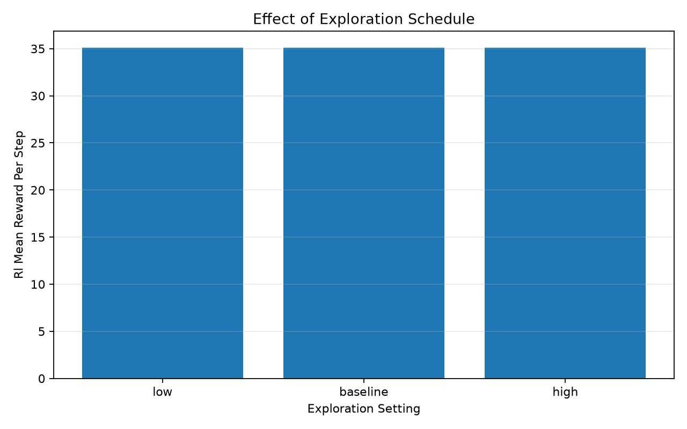

# 03. Kết quả sinh từ artifact thực

File này được tạo bởi `python scripts/export_report.py`. Không chỉnh tay metric; thay cấu hình/dữ liệu thì chạy thực nghiệm và xuất lại.

## Phân loại dataset Kaggle

Nguồn: ziya07/diabetes-clinical-dataset100k-rows. SHA-256 CSV: `608a44d5619cd7ce7fdf97f6e8d3f754d1d0de72d7ff073122aa5654e1db7da8`.
Artifact UTC: 2026-11-02T17:06:08.047610+00:00; seed 42.

100,000 dòng gốc → 96,146 dòng theo 8 X + y; bỏ 3,854 dòng trùng; 91 nhóm X có nhãn mâu thuẫn được giữ cùng tập.

| Tập | Số dòng | Nhãn 1 | Nhãn 0 |
|---|---:|---:|---:|
| train | 57688 | 5090 | 52598 |
| validation | 19229 | 1696 | 17533 |
| test | 19229 | 1696 | 17533 |

MLP `15 -> 16 ReLU Dropout(0.1) -> 8 ReLU -> 1 logit`; best epoch 78/90; batch 512; threshold 0.5.

| Mô hình | Accuracy | Precision | Recall | F1 | ROC-AUC | AP | Brier |
|---|---:|---:|---:|---:|---:|---:|---:|
| MLP | 97.01% | 100.00% | 66.16% | 79.63% | 97.65% | 87.76% | 0.02441 |
| Logistic Regression | 95.87% | 87.14% | 62.32% | 72.67% | 96.19% | 81.89% | 0.03284 |
| Majority baseline | 91.18% | 0.00% | 0.00% | 0.00% | 50.00% | 8.82% | 0.08820 |

Confusion matrix có thứ tự nhãn [0,1], hàng thật/cột dự đoán:

- MLP: TN=17533, FP=0, FN=574, TP=1122.
- Logistic Regression: TN=17377, FP=156, FN=639, TP=1057.
- Majority baseline: TN=17533, FP=0, FN=1696, TP=0.

Accuracy phải được đọc cùng Recall: majority baseline cho thấy ảnh hưởng lệch lớp. Đây là một split nhóm có seed cố định, chưa có external validation hoặc hiệu chuẩn. Không coi kết quả là độ chính xác y khoa; nguồn Kaggle chưa mô tả đủ provenance/label generation. Clinical notes, năm, địa điểm và race không nằm trong X.

Dữ liệu chi tiết: `artifacts/ml/model_comparison.csv`, `splits.csv`, `test_predictions.csv`, `training_history.csv`.

## Q-learning so với Rule-based

Nguồn gốc Python được bảo toàn: hash trùng = **True**. Train 5000 episode × 20 lượt; evaluate 500 episode, không khám phá/cập nhật Q.

| Agent baseline | Reward/lượt đánh giá | Tỷ lệ giảm giá |
|---|---:|---:|
| RL | 35.1275 | 0.00% |
| Rule-based | 34.9685 | 0.00% |

| Agent, 5 seed | Mean reward/lượt | Sample SD |
|---|---:|---:|
| RL | 34.8919 | 0.3132 |
| Rule-based | 34.9321 | 0.2496 |

| Alpha | RL reward/lượt |
|---|---:|
| 0.01 | 35.2475 |
| 0.1 | 35.2475 |
| 0.5 | 28.5085 |

| Exploration | Epsilon start/min/decay | RL reward/lượt |
|---|---|---:|
| low | 0.05 / 0.02 / 0.999 | 35.1045 |
| baseline | 0.2 / 0.02 / 0.995 | 35.1045 |
| high | 0.5 / 0.05 / 0.995 | 35.1045 |

RL không vượt Rule một cách rõ ràng ở môi trường này; không có kiểm định chứng minh ưu thế. Alpha/epsilon chỉ so trên một training seed mỗi cấu hình. State quan sát gốc bỏ own_previous_action và time_remaining nên không khẳng định Markov đầy đủ/hội tụ tối ưu. Reward là lợi nhuận giả lập, không liên quan kết quả y tế.

## Đánh giá truy xuất tri thức

Chế độ: retrieval-based QA. 11 câu trong phạm vi, 3 câu ngoài phạm vi; threshold cosine=0.08.

| Chỉ số | Giá trị |
|---|---:|
| Hit@1 | 90.91% |
| Hit@3 | 100.00% |
| Rejection accuracy | 100.00% |

Bộ câu hỏi nhỏ do tác giả soạn, cùng ngôn ngữ/nội dung KB; không phải benchmark độc lập.

Kết quả từng câu kể cả câu sai: `artifacts/retrieval/question_results.csv`.

## Workflow và kiểm thử

| Kiểm tra workflow | Kết quả |
|---|---|
| prediction_completed | PASS |
| real_prediction_score | PASS |
| agent_order | PASS |
| source_backed_answer | PASS |
| out_of_domain_skips_prediction | PASS |
| sqlite_saved_three_runs | PASS |

JUnit XML: 25 tests; 0 failures; 0 errors; 0 skipped.

Workflow dùng hồ sơ giả định để kiểm tra phần mềm, không đo độ chính xác y khoa. Unit/integration tests không thay thế kiểm tra giao diện trực quan. Xem `docs/04_VERIFICATION.md` cho phạm vi đã kiểm chứng.

## Phiên bản môi trường model

- torch: 2.15.0
- numpy: 2.5.4
- pandas: 2.3.3
- scikit-learn: 1.9.1
