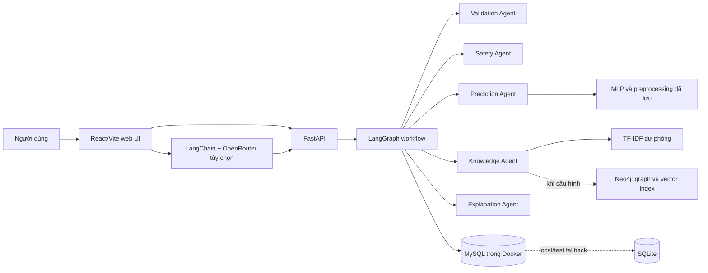

# BÁO CÁO ĐỒ ÁN

## Hệ thống đa tác tử hỗ trợ tìm hiểu và phân loại dữ liệu tiểu đường

**Dự án:** Diabetes Agent Lab  
**Kiến trúc:** LangGraph, LangChain, MySQL và Neo4j  
**Nền tảng demo:** Python, FastAPI và giao diện web  
**Ngày lập:** 05/11/2026

> Báo cáo này dùng cấu trúc chương mục của tài liệu PDF tham khảo. Toàn bộ mô tả triển khai, số liệu và đánh giá bên dưới được lấy từ repository và artifact của Diabetes Agent Lab. Không dùng tên cá nhân, số liệu hay chức năng riêng của tài liệu tham khảo.

---

## Tóm tắt

Báo cáo trình bày Diabetes Agent Lab, một ứng dụng đa tác tử dùng cho mục đích học tập và trình diễn quy trình xử lý dữ liệu tiểu đường. Hệ thống kết hợp kiểm tra đầu vào và cảnh báo an toàn theo luật, mô hình học có giám sát để phân loại nhãn trong một bộ dữ liệu Kaggle, truy xuất thông tin sức khỏe có dẫn nguồn, giải thích đầu ra và lưu vết thực thi. Một thí nghiệm Q-learning kế thừa từ mã AGENT02 được giữ riêng trong môi trường mô phỏng thương mại điện tử.

Pipeline phân loại được đánh giá trên 96.146 dòng sau khi loại bản ghi trùng theo tám đặc trưng đầu vào và nhãn. Trên tập kiểm tra, MLP đạt Accuracy 97,01%, Recall 66,16%, F1 79,63% và ROC-AUC 97,65%. Majority baseline đạt Accuracy 91,18% nhưng Recall bằng 0%, cho thấy Accuracy đơn lẻ không phản ánh khả năng nhận diện lớp dương. Bộ kiểm tra truy xuất tri thức gồm 14 câu do tác giả biên soạn đạt Hit@1 90,91%, Hit@3 100% và độ chính xác từ chối 100%; quy mô và tính độc lập của bộ câu hỏi còn hạn chế. Trong mô phỏng Q-learning, kết quả trung bình nhiều seed gần với rule-based và chưa cho thấy ưu thế rõ ràng của RL.

> Các kết quả chỉ mô tả thí nghiệm phần mềm trên dữ liệu và thiết lập hiện có. Chúng không xác nhận khả năng chẩn đoán, tiên lượng nguy cơ cá nhân hay hiệu quả lâm sàng. Nguồn Kaggle chưa mô tả đầy đủ xuất xứ dữ liệu và quy trình tạo nhãn.

**Từ khóa:** hệ đa tác tử, LangGraph, phân loại, MLP, Q-learning, truy xuất tri thức, tiểu đường.

## Tuyên bố phạm vi

DiaCare AI trong báo cáo này là tên giao diện demo của project Diabetes Agent Lab. Đây là nguyên mẫu giáo dục, dùng hồ sơ giả định và chưa được kiểm chứng lâm sàng. Không nhập thông tin sức khỏe thật hoặc dữ liệu định danh. Điểm MLP là điểm phân loại nhãn của dataset, không phải chẩn đoán hay nguy cơ cá nhân. Các chức năng hỏi đáp không kê đơn hoặc điều chỉnh điều trị.

## Mục lục

1. [Giới thiệu](#1-giới-thiệu)
2. [Hệ đa tác tử](#2-hệ-đa-tác-tử)
3. [Kiến trúc tổng quan](#3-kiến-trúc-tổng-quan)
4. [Các thành phần hệ thống](#4-các-thành-phần-hệ-thống)
5. [Code và demo](#5-code-và-demo)
6. [Kết luận và hướng phát triển](#6-kết-luận-và-hướng-phát-triển)
7. [Tài liệu tham khảo](#tài-liệu-tham-khảo)

## Từ viết tắt

| Viết tắt | Diễn giải trong báo cáo |
|---|---|
| MAS | Multi-agent system, hệ đa tác tử |
| PEAS | Performance, Environment, Actuators, Sensors |
| MLP | Multilayer perceptron |
| KB | Knowledge base, kho tri thức |
| RAG | Retrieval-augmented generation |
| API | Application programming interface |
| RL | Reinforcement learning, học tăng cường |

## 1. Giới thiệu

### 1.1 Bối cảnh

Hệ thống đa tác tử phân chia một nhiệm vụ thành các vai trò có trách nhiệm riêng, rồi phối hợp kết quả thông qua một quy trình điều phối. Trong một ứng dụng học tập, cách tổ chức này giúp quan sát rõ các bước kiểm tra, dự đoán, tìm bằng chứng và giải thích thay vì chỉ nhận một nhãn đầu ra.

Đồ án xây dựng một demo về dữ liệu tiểu đường nhằm minh họa các thành phần đó. Tên gọi “hỗ trợ tìm hiểu” phản ánh phạm vi giáo dục và nghiên cứu của ứng dụng. Hệ thống không thay thế xét nghiệm, chẩn đoán hoặc tư vấn của nhân viên y tế.

### 1.2 Mục tiêu

- Xây pipeline tái lập từ dữ liệu Kaggle đến tiền xử lý, huấn luyện, đánh giá và lưu artifact.
- Tách kiểm tra schema, kiểm tra miền dữ liệu, cảnh báo an toàn, phân loại, truy xuất bằng chứng và giải thích thành các thành phần chuyên trách.
- Điều phối luồng hồ sơ bằng LangGraph, ghi lại quyết định định tuyến và kết quả từng bước.
- Cung cấp giao diện web và API để quan sát workflow, truy vấn kho tri thức và xem thí nghiệm.
- Đánh giá độc lập mô hình phân loại, truy xuất tri thức và thí nghiệm Q-learning kế thừa.

### 1.3 Phạm vi và câu hỏi nghiên cứu

Mô hình học nhãn `diabetes` trong bộ dữ liệu Kaggle đã chọn, sử dụng tám trường hồ sơ làm đầu vào. Do các đầu vào có HbA1c và glucose, và dữ liệu không mô tả thời điểm dự báo theo chiều dọc, bài toán được xem là **phân loại nhãn của bộ dữ liệu**, không phải dự báo mắc bệnh trong tương lai.

Các câu hỏi chính là: (1) pipeline có thể huấn luyện và đánh giá MLP cùng baseline trên một phép chia nhóm tránh trùng đặc trưng giữa các tập hay không; (2) nhiều agent có thể phối hợp thành workflow có điều kiện và lưu vết hay không; (3) truy xuất có thể trả về thông tin nền cùng nguồn và từ chối câu hỏi ngoài phạm vi hay không; và (4) kết quả Q-learning có vượt rule-based trong mô phỏng kế thừa hay không.

## 2. Hệ đa tác tử

### 2.1 Tác tử và điều phối

Một tác tử nhận dữ liệu đầu vào, thực hiện mục tiêu đã xác định và trả về kết quả theo hợp đồng dữ liệu. Trong đồ án, các agent là thành phần Python trong cùng ứng dụng. Orchestrator điều phối thứ tự và điều kiện chạy; các agent không phải tiến trình phân tán và không tự thương lượng.

LangGraph biểu diễn workflow hồ sơ thành state graph với nhánh có điều kiện. LangChain được dùng riêng cho tab hội thoại tùy chọn: mô hình qua OpenRouter có thể chọn một hoặc nhiều công cụ trong allowlist backend. Quyền gọi công cụ, số lượt và schema vẫn do ứng dụng kiểm soát.

### 2.2 Phân loại học có giám sát

MLP là mạng nơ-ron truyền thẳng học ánh xạ từ vector đặc trưng đến logit. MLP của dự án có kích thước `15 → 16 → 8 → 1`, ReLU và dropout 0,1. Mô hình được huấn luyện với `BCEWithLogitsLoss`, Adam, learning rate 0,001, weight decay 0,0001, batch size 512 và tối đa 100 epoch; validation dùng chọn checkpoint. Ngưỡng phân lớp 0,5 được cố định.

Logistic Regression được dùng làm baseline tuyến tính. Majority baseline dự đoán lớp phổ biến nhất, giúp thể hiện ảnh hưởng của mất cân bằng lớp. Vì vậy, kết quả được báo cáo bằng nhiều chỉ số như Recall, F1, ROC-AUC và AP bên cạnh Accuracy.

### 2.3 Q-learning

Q-learning cập nhật giá trị hành động theo công thức:

`Q(s,a) ← Q(s,a) + α [r + γ maxₐ′ Q(s′,a′) − Q(s,a)]`

Ở trạng thái kết thúc, mục tiêu cập nhật chỉ dùng reward hiện tại. Agent chọn hành động theo epsilon-greedy trong giai đoạn huấn luyện. Phần mã AGENT02 mô phỏng hai cửa hàng quyết định giảm hoặc giữ giá; reward biểu diễn lợi nhuận trong mô phỏng, không có ý nghĩa y tế.

### 2.4 Truy xuất tri thức

Kho tri thức gồm các tài liệu Markdown tiếng Việt có nguồn tham khảo. Phương án cục bộ tạo chunk, vector hóa TF-IDF unigram/bigram và xếp hạng bằng cosine similarity; ngưỡng phù hợp tối thiểu là 0,08. Khi Neo4j được cấu hình và sẵn sàng, Knowledge Agent có thể bổ sung truy xuất ngữ nghĩa và facts từ knowledge graph. Nếu không, TF-IDF cục bộ là phương án dự phòng. Chế độ QA cơ bản trả về đoạn bằng chứng đã biên soạn; nó không tự sinh câu trả lời như một mô hình RAG generator.

### 2.5 PEAS của ứng dụng

| Thành phần | Diễn giải cho Diabetes Agent Lab |
|---|---|
| Performance | Kiểm tra schema/miền đầu vào, route đúng agent, giữ nguồn bằng chứng, giải thích được trace và xử lý an toàn ngoài miền. Các chỉ số phần mềm này không phải kết cục sức khỏe. |
| Environment | Server web/API chạy cục bộ hoặc qua cấu hình Docker; artifact model, dataset và KB; MySQL/Neo4j khi được cấu hình; OpenRouter chỉ trong tab LLM tùy chọn. |
| Actuators | Gửi cảnh báo theo luật, chạy hoặc bỏ qua MLP, truy xuất bằng chứng, trả giải thích, ghi execution/trace và phản hồi giao diện. |
| Sensors | Hồ sơ có cấu trúc, câu hỏi người dùng, model/KB artifact và trạng thái dịch vụ/cơ sở dữ liệu. |

PEAS mô tả ranh giới phần mềm của demo. Nó không hàm ý agent có quyền hành động lên bệnh nhân hoặc hệ thống y tế.

## 3. Kiến trúc tổng quan

### 3.1 Yêu cầu chức năng

1. Nhận hồ sơ giả định theo schema xác định và từ chối dữ liệu sai định dạng.
2. Kiểm tra miền quan sát của các biến số; bỏ qua mô hình khi có biến ngoài khoảng train.
3. Tạo điểm phân loại nhãn dataset, cảnh báo an toàn theo luật và phần giải thích có nêu giới hạn.
4. Truy xuất thông tin chung có nguồn, đồng thời xử lý câu hỏi ngoài phạm vi và yêu cầu chẩn đoán/kê thuốc cá nhân.
5. Lưu execution, trace và dữ liệu phục vụ audit vào cơ sở dữ liệu quan hệ; lưu tài liệu, chunk, facts và quan hệ provenance trong Neo4j khi dịch vụ này được cấu hình.
6. Cung cấp giao diện demo và API health, schema, prediction, hỏi đáp, lịch sử và artifact thực nghiệm.

### 3.2 Yêu cầu phi chức năng và ràng buộc

Hệ thống chạy cục bộ hoặc qua Docker Compose, giữ artifact huấn luyện riêng với request thời gian chạy và giới hạn số bước/công cụ. Dữ liệu demo phải là hồ sơ giả định. Hệ thống không được diễn giải điểm model thành chẩn đoán, không tự kê đơn và phải giữ nguồn của bằng chứng truy xuất. Khi dịch vụ ngoài hoặc Neo4j chưa sẵn sàng, trạng thái lỗi/fallback cần thể hiện rõ.

### 3.3 Kiến trúc



Sơ đồ thể hiện kiến trúc phần mềm trong mã nguồn. MySQL là lựa chọn system-of-record khi chạy stack Docker; SQLite còn dùng cho local/test fallback theo cấu hình. Neo4j cung cấp kho graph và vector index khi được thiết lập; TF-IDF cục bộ không phụ thuộc dịch vụ đó. Tab LLM là luồng hội thoại tùy chọn riêng, không đồng nhất với template giải thích của workflow hồ sơ.

### 3.4 Luồng xử lý hồ sơ

1. FastAPI/Pydantic kiểm tra kiểu và trường bắt buộc.
2. Validation Agent đối chiếu khoảng số với miền train và ghi cảnh báo cho trường hợp ngoài miền.
3. Safety Agent áp dụng quy tắc cảnh báo độc lập với điểm MLP.
4. Nếu dữ liệu trong miền, Prediction Agent biến đổi bằng preprocessor đã lưu và chạy MLP ở chế độ inference. Nếu ngoài miền, graph đánh dấu bỏ qua dự đoán.
5. Knowledge Agent được gọi khi có cảnh báo hoặc cần thông tin nền; bằng chứng và nguồn được giữ trong kết quả.
6. Explanation Agent kết hợp đầu ra thành nội dung giải thích có giới hạn.
7. Orchestrator ghi kết quả, quyết định định tuyến, trace và dữ liệu audit.

## 4. Các thành phần hệ thống

### 4.1 Nguồn dữ liệu

Dự án dùng Diabetes Clinical Dataset (100k rows) của uploader `ziya07` trên Kaggle theo chỉ định trong project. Metadata ghi giấy phép CC0. Tệp gốc có 100.000 dòng, 17 cột và không có ô NaN tại lần kiểm tra được ghi lại. Tài liệu nguồn không mô tả đầy đủ nơi thu thập ban đầu, patient ID, đơn vị đo và quy trình tạo nhãn. Báo cáo vì thế không tự khẳng định dữ liệu là bệnh án thật hoặc dữ liệu tổng hợp.

### 4.2 Biến đầu vào và chất lượng dữ liệu

Tám biến đầu vào gồm gender, age, hypertension, heart disease, smoking history, BMI, HbA1c và blood glucose. Nhãn mục tiêu là `diabetes`. Các cột year, location, năm cột race và clinical notes không được đưa vào mô hình. Các đơn vị trong form được dùng như quy ước demo và cần được xác minh với nhà cung cấp trước mọi sử dụng ngoài nghiên cứu.

Sau khi chọn tám X và y, dự án bỏ 3.854 dòng trùng, còn 96.146 dòng. Có 91 nhóm X giống hệt nhau nhưng mang nhãn khác nhau; các nhóm này được giữ và không bị tách qua các tập. Do không có patient ID, cách xử lý này không chứng minh độc lập ở cấp cá nhân.

### 4.3 Chia tập và biến đổi

Nhóm được tạo từ tám đặc trưng đã chuẩn hóa, không đưa nhãn vào hash. Phép chia nhóm có phân tầng tạo train 57.688 dòng, validation 19.229 dòng và test 19.229 dòng (seed 42). Median imputer và StandardScaler cho nhánh số chỉ được fit trên train. Các biến phân loại được one-hot theo schema cố định; vector cuối có 15 chiều. Validation dùng chọn checkpoint; test chỉ dùng đánh giá cuối.

### 4.4 Deep Learning và mô hình bảng

Prediction Agent nạp preprocessor, checkpoint PyTorch và Logistic Regression baseline từ artifact đã lưu. MLP có kiến trúc `15 → 16 → 8 → 1`; đầu ra sigmoid được so với ngưỡng kỹ thuật 0,5. API không huấn luyện lại model trong lúc xử lý request. Một score không được hiệu chuẩn thành xác suất nguy cơ cá nhân.

| Thiết lập | Giá trị |
|---|---|
| Loss | `BCEWithLogitsLoss` |
| Optimizer | Adam, learning rate 0,001, weight decay 0,0001 |
| Batch size | 512 |
| Huấn luyện tối đa | 100 epoch; checkpoint theo validation, dừng sớm patience 12 |
| Ngưỡng | 0,5, đặt trước khi đánh giá test |
| Đóng gói | `mlp.pt`, `preprocessor.joblib`, `logistic.joblib`, `evaluation.json` |

### 4.5 Knowledge Base, retrieval và Safety Gate

Knowledge Agent chia tài liệu trong `knowledge_base/` thành đoạn, dùng TF-IDF/cosine ở chế độ cục bộ và gắn URL/ngày truy cập vào evidence. Nếu Neo4j cùng embedding model sẵn sàng, có thể kết hợp truy xuất ngữ nghĩa và facts trong graph; trạng thái được trả ra để phân biệt fallback. Không tuyên bố đã triển khai một generator RAG trong luồng QA cơ bản.

Safety Agent áp dụng quy tắc trên các trường đã nhập, độc lập với model. Quy tắc mức ngưỡng dựa trên giá trị HbA1c/glucose trong demo chỉ tạo thông điệp và dẫn nguồn; không xác nhận bệnh. Đây không phải bộ câu hỏi sàng lọc lâm sàng như trong báo cáo mẫu.

### 4.6 Điều phối, lưu trữ và LLM tùy chọn

Workflow hồ sơ đi qua Validation, Safety, Prediction (nếu trong miền), Knowledge (khi cần) và Explanation. Mỗi lần gọi ghi input/output, trạng thái, thời lượng và lý do định tuyến vào trace. LLM Agent trong tab riêng dùng LangChain/OpenRouter để chọn tool trong allowlist; tính năng này cần API key/model cấu hình và có thể tạo chi phí. Khi bật, nội dung hội thoại được gửi tới provider đã cấu hình. Nó không thay thế graph điều phối hồ sơ hay template Explanation Agent.

| Thành phần | Trách nhiệm | Đầu ra chính |
|---|---|---|
| Orchestrator / LangGraph | Điều phối graph, ghi lý do định tuyến và trace | Kết quả workflow, routing, audit trace |
| Validation Agent | Kiểm tra miền train và trường hợp thiếu thông tin | Miền hợp lệ, biến ngoài khoảng, warnings |
| Safety Agent | Đánh giá quy tắc cảnh báo trên trường đã nhập | Mức cảnh báo, thông điệp, trích dẫn |
| Prediction Agent | Nạp artifact và phân loại nhãn dataset | Điểm MLP, nhãn kỹ thuật, baseline score |
| Knowledge Agent | Truy xuất chunk/facts có provenance hoặc fallback | Trạng thái QA, evidence, nguồn, graph facts |
| Explanation Agent | Kết hợp kết quả các agent bằng template | Giải thích, thông tin chung, giới hạn |
| LLM tool agent (tùy chọn) | Chọn tool trong allowlist cho hội thoại | Phản hồi, tool calls, trace hội thoại |
| Q-learning agent (độc lập) | Chọn hành động trong mô phỏng giá | Q-table, reward và artifact RL |

MySQL là cơ sở dữ liệu quan hệ chính theo cấu hình Docker Compose; SQLite được giữ cho local/test fallback. Neo4j phục vụ graph tri thức khi cấu hình. Báo cáo không đồng nhất khả năng có trong cấu hình với bằng chứng rằng mọi dịch vụ đều đã được kiểm thử vận hành liên kết ở môi trường production.

### 4.7 Giao diện và API

FastAPI phục vụ giao diện React/Vite đã build và API. Các endpoint chính gồm `GET /api/health`, `GET /api/schema`, `POST /api/predict`, `POST /api/ask`, lịch sử, experiments và artifact trong allowlist. Giao diện có các tab tổng quan, dự đoán nghiên cứu, kho tri thức, LLM Agent, workflow và thực nghiệm. `index.html` ở thư mục gốc là demo JavaScript cũ, không đại diện giao diện tiểu đường hiện tại.

### 4.8 Kết quả thực nghiệm

#### Phân loại

Kết quả dưới đây được đọc từ artifact đánh giá đã lưu trong project. Tập test gồm 19.229 dòng, trong đó 1.696 nhãn dương và 17.533 nhãn âm.

| Mô hình | Accuracy | Precision | Recall | F1 | ROC-AUC | AP | Brier |
|---|---:|---:|---:|---:|---:|---:|---:|
| MLP | 97,01% | 100,00% | 66,16% | 79,63% | 97,65% | 87,76% | 0,02441 |
| Logistic Regression | 95,87% | 87,14% | 62,32% | 72,67% | 96,19% | 81,89% | 0,03284 |
| Majority baseline | 91,18% | 0,00% | 0,00% | 0,00% | 50,00% | 8,82% | 0,08820 |

Ma trận nhầm lẫn MLP (hàng là nhãn thật, cột là dự đoán; thứ tự `[0,1]`) là TN=17.533, FP=0, FN=574, TP=1.122. Ở ngưỡng 0,5, MLP không tạo false positive trong split này nhưng bỏ sót 574 mẫu dương. Con số đó làm rõ vì sao Accuracy cao không đủ để khẳng định mô hình nhận diện tốt lớp dương.

#### Q-learning so với rule-based

Mã Python nguồn của AGENT02 được giữ trong `legacy/agent02_experiment.py`; báo cáo dự án ghi nhận hash nguồn gốc trùng. Mỗi cấu hình chạy 5.000 episode × 20 lượt; đánh giá cơ sở dùng 500 episode không khám phá và không cập nhật Q.

| Agent | Reward trung bình/lượt, đánh giá cơ sở | Reward trung bình/lượt, 5 seed | Độ lệch chuẩn mẫu, 5 seed |
|---|---:|---:|---:|
| RL | 35,1275 | 34,8919 | 0,3132 |
| Rule-based | 34,9685 | 34,9321 | 0,2496 |

Ở phép so sánh nhiều seed, hai agent có reward trung bình gần nhau; kết quả không chứng minh RL tốt hơn rule. Reward này chỉ phản ánh lợi nhuận trong môi trường mô phỏng. State của mã kế thừa không chứa own_previous_action và time_remaining, nên báo cáo không khẳng định trạng thái Markov đầy đủ hoặc bảo đảm hội tụ tối ưu.

#### Đánh giá truy xuất tri thức

Bộ đánh giá có 14 câu do tác giả soạn: 11 câu trong phạm vi và 3 câu ngoài phạm vi. Với ngưỡng cosine 0,08, Hit@1 là 10/11 (90,91%), Hit@3 là 11/11 (100%) và độ chính xác từ chối là 3/3 (100%). Bộ câu hỏi nhỏ, cùng ngôn ngữ/nội dung với kho tri thức và không độc lập với người biên soạn; các tỷ lệ này không đại diện cho benchmark QA bên ngoài.

#### Kiểm thử phần mềm

> Tài liệu kiểm chứng trong repository ghi lại 25 unit/integration tests đạt, không có failures, errors hoặc skipped; sáu điều kiện workflow đạt; và HTTP smoke test có `all_passed=true`. Đây là bằng chứng kiểm tra phần mềm ở thời điểm được ghi lại, không phải kiểm định mô hình y khoa. Tài liệu cũng ghi rõ việc xác nhận rendering và tương tác trực tiếp trong Chrome chưa hoàn tất.

### 4.9 Đánh giá theo mục tiêu và hạn chế

| Mục tiêu | Bằng chứng trong repository | Đánh giá |
|---|---|---|
| G1. Tạo pipeline dữ liệu/model có artifact và phép chia nhóm | `artifacts/ml/`, `docs/03_DATASET.md`, metric và split đã lưu | Đạt ở phạm vi split nội bộ; chưa có external validation hoặc xác minh provenance. |
| G2. Điều phối các agent có nhánh và trace | LangGraph workflow, workflow evaluation và trace lưu trữ | Đạt theo các kịch bản đã ghi; không phải hệ agent phân tán/tự thương lượng. |
| G3. QA dựa bằng chứng và từ chối ngoài phạm vi | Artifact retrieval: Hit@1 10/11, Hit@3 11/11, từ chối 3/3 | Đạt trên bộ nhỏ do tác giả soạn; chưa phải benchmark độc lập. |
| G4. Kế thừa và so sánh Q-learning với rule | Module RL, hash mã gốc và artifact nhiều seed | Đạt về tích hợp thí nghiệm; chưa có bằng chứng RL ưu thế rule. |
| G5. Cung cấp API, UI và thông tin vận hành | FastAPI, UI build, smoke HTTP và docs chạy | Đạt kiểm tra HTTP đã ghi; browser UI QA và kiểm chứng production chưa đầy đủ. |
| G6. Kiểm thử tự động và tài liệu tái lập | JUnit XML, tests, README, requirements lock, scripts | Đạt theo lần chạy được lưu trong docs; báo cáo này không chạy lại test. |

### 4.10 Thảo luận và giới hạn

MLP đạt chỉ số tổng thể cao hơn Logistic Regression trên split hiện tại, nhưng Recall 66,16% cho thấy còn tỷ lệ bỏ sót nhãn dương đáng kể. Majority baseline có Accuracy 91,18% mà không nhận diện được nhãn dương, xác nhận cần báo cáo nhiều metric. MLP có Precision 100% trên test cụ thể này không đảm bảo precision đó sẽ giữ nguyên ở quần thể khác.

Kết quả bị giới hạn bởi nguồn dữ liệu chưa rõ provenance, nhãn chưa được mô tả đầy đủ, thiếu patient ID và thiếu external validation. Việc đưa HbA1c và glucose vào X cũng làm rõ rằng đây là phân loại nhãn của bảng dữ liệu có chứa biến xét nghiệm, không phải dự báo nguy cơ trước xét nghiệm. Chưa có hiệu chuẩn, đánh giá fairness đầy đủ hoặc kiểm định theo bệnh viện, thời gian hay quần thể Việt Nam.

Truy xuất TF-IDF dễ giải thích và phù hợp kho nhỏ; heuristic về phạm vi và benchmark nhỏ có thể không xử lý được cách diễn đạt mới. Neo4j/vector retrieval mở rộng khả năng graph/semantic khi được cấu hình nhưng không loại bỏ nhu cầu đánh giá chất lượng bằng chứng. LLM tool agent tùy chọn phụ thuộc cấu hình OpenRouter, có thể phát sinh chi phí và cần tiếp tục kiểm soát đầu vào, tool allowlist, trace và độ trung thành với nguồn.

Thí nghiệm RL không cho thấy ưu thế rõ ràng. Chênh lệch nhỏ giữa RL và rule trong reward giả lập không nên được diễn giải như bằng chứng về hiệu quả trong lĩnh vực y tế. Mô phỏng vẫn hữu ích để minh họa Q-learning, epsilon-greedy và so sánh nhiều seed trong một bài toán tách biệt.

## 5. Code và demo

### 5.1 Cấu trúc mã nguồn

```text
diabetes_demo/     pipeline, agents, API, graph workflow, lưu trữ, RL
frontend/          mã nguồn giao diện React/Vite
web/               bundle giao diện FastAPI phục vụ
knowledge_base/    tài liệu và metadata nguồn
artifacts/         model, metrics, splits, retrieval và RL outputs
docs/              yêu cầu, kiến trúc, dataset, kiểm chứng, hướng dẫn
tests/             unit và integration tests
```

### 5.2 Mã nguồn tiêu biểu

Graph hồ sơ được tạo từ module `langgraph_workflow.py`. Hình thức cấu trúc trong mã nguồn là:

```python
builder.add_edge(START, "validation")
builder.add_edge("validation", "safety")
builder.add_conditional_edges(
    "safety",
    self._route_prediction,
    {"prediction": "prediction", "skip_prediction": "skip_prediction"},
)
builder.add_edge("explanation", END)
```

Đoạn trên được rút gọn từ `diabetes_demo/langgraph_workflow.py`; graph còn có nhánh knowledge và các node bỏ qua. Prediction Agent nạp artifact đã lưu và thực hiện inference; Knowledge Agent trả evidence và metadata nguồn. Các đoạn mã liên quan nằm tại `diabetes_demo/langgraph_workflow.py`, `diabetes_demo/agents.py`, `diabetes_demo/knowledge.py` và `diabetes_demo/llm_agent.py`.

### 5.3 Cài đặt và chạy

Từ thư mục dự án, README hướng dẫn tạo virtual environment, cài `requirements-lock.txt`, huấn luyện model, chạy thí nghiệm và khởi động FastAPI. Cấu hình Docker Compose bổ sung MySQL và Neo4j; LLM Agent cần cấu hình OpenRouter riêng. Nên dùng hồ sơ giả định và không đưa API key vào báo cáo hoặc mã nguồn công khai.

```powershell
python -m venv .venv
.\.venv\Scripts\python.exe -m pip install -r requirements-lock.txt
.\.venv\Scripts\python.exe -m diabetes_demo.data
.\.venv\Scripts\python.exe -m diabetes_demo.train
.\.venv\Scripts\python.exe -m diabetes_demo.evaluate
.\.venv\Scripts\python.exe -m uvicorn diabetes_demo.api:app --host 127.0.0.1 --port 8000
```

### 5.4 Kịch bản demo

1. Mở tổng quan và xác nhận trạng thái dịch vụ.
2. Dùng nút điền hồ sơ giả định; chạy workflow và xem lần lượt validation, safety, prediction, knowledge và explanation.
3. Thử trường số ngoài miền train để thấy Prediction Agent bị bỏ qua.
4. Hỏi câu có bằng chứng, ví dụ HbA1c phản ánh điều gì; mở nguồn đi kèm câu trả lời.
5. Thử câu hỏi ngoài phạm vi hoặc yêu cầu kê thuốc để kiểm tra thông điệp từ chối.
6. Mở trang thực nghiệm để trình bày Recall, confusion matrix và majority baseline cùng nhau.
7. Trình bày Q-learning như mô phỏng thương mại độc lập, không liên hệ kết quả y tế.

Kịch bản chi tiết có trong [docs/report/04_DEMO_SCRIPT.md](04_DEMO_SCRIPT.md). Tài liệu kiểm chứng nêu rõ Chrome rendering/interactions chưa được xác nhận, nên cần mở giao diện thật trước khi trình bày.

### 5.5 Hạn chế triển khai

Chưa có external validation, calibration/fairness đầy đủ, dữ liệu dọc, tích hợp bệnh viện hoặc hosting công khai. Luồng QA cơ bản không sinh bằng LLM; tab LLM tùy chọn qua OpenRouter là tính năng riêng. Neo4j hybrid retrieval chỉ khả dụng khi cấu hình đúng; fallback cục bộ là TF-IDF. Tài liệu tests và smoke HTTP ghi kết quả của các lần chạy trước, không phải lần chạy mới trong quá trình soạn report.

## 6. Kết luận và hướng phát triển

Diabetes Agent Lab cung cấp pipeline phân loại có artifact, workflow đa tác tử có điều kiện và trace, cảnh báo dựa trên luật, kho tri thức có nguồn và thí nghiệm Q-learning kế thừa trong mô phỏng độc lập. Các kết quả thực nghiệm được lưu thành JSON, CSV và biểu đồ để có thể kiểm tra lại.

> Các kết quả hiện tại chứng minh một nguyên mẫu phần mềm chạy trên cấu hình dự án; chúng không chứng minh giá trị chẩn đoán hoặc lợi ích lâm sàng. Mọi trình diễn cần dùng hồ sơ giả định và trình bày rõ điểm model không phải xác suất nguy cơ cá nhân.

Các bước phát triển tiếp theo:

1. Xác minh provenance, nhãn, đơn vị và quy trình tạo dữ liệu với nguồn cung cấp.
2. Thu thập bộ kiểm tra ngoài, đánh giá hiệu chuẩn và hiệu năng theo nhóm với quy trình phù hợp.
3. Tăng tính độc lập và quy mô bộ câu hỏi, đánh giá độ đúng nguồn, mức từ chối và độ bền với diễn đạt khác nhau.
4. Nếu sử dụng LLM để tổng hợp, đo độ bám sát evidence và khả năng trích dẫn trước khi mở rộng.
5. Thiết kế lại state/horizon cho thí nghiệm RL nếu mục tiêu nghiên cứu yêu cầu đánh giá thuật toán chặt chẽ hơn.
6. Hoàn thiện kiểm tra giao diện trình duyệt và vận hành dịch vụ ở môi trường cấu hình đầy đủ.

## Tài liệu tham khảo

1. `ziya07`, [Diabetes Clinical Dataset (100k rows)](https://www.kaggle.com/datasets/ziya07/diabetes-clinical-dataset100k-rows), Kaggle. Dự án ghi nhận metadata license CC0; truy cập 03/11/2026.
2. World Health Organization, [Diabetes fact sheet](https://www.who.int/news-room/fact-sheets/detail/diabetes).
3. Centers for Disease Control and Prevention, [Diabetes Testing](https://www.cdc.gov/diabetes/diabetes-testing/index.html), [Symptoms of Diabetes](https://www.cdc.gov/diabetes/signs-symptoms/index.html), [About Type 2 Diabetes](https://www.cdc.gov/diabetes/about/about-type-2-diabetes.html), [Preventing Type 2 Diabetes](https://www.cdc.gov/diabetes/prevention-type-2/index.html).
4. PyTorch, [Optimization Tutorial](https://docs.pytorch.org/tutorials/beginner/basics/optimization_tutorial.html).
5. Scikit-learn, [StratifiedGroupKFold](https://scikit-learn.org/stable/modules/generated/sklearn.model_selection.StratifiedGroupKFold.html).
6. Sinh viên cung cấp, `agent02_code.tex` (nội dung Python mô phỏng Q-learning và rule-based agent).

## Phụ lục A. Tệp và artifact hỗ trợ

- [README](../../README.md)
- [Yêu cầu và phạm vi](../01_REQUIREMENTS.md)
- [Kiến trúc và hợp đồng agent](../02_ARCHITECTURE.md)
- [Mô tả dataset](../03_DATASET.md)
- [Phạm vi kiểm chứng](../04_VERIFICATION.md)
- [Kết quả thực nghiệm](03_RESULTS.md)
- [Mã sinh bảng kết quả](../../scripts/export_report.py)

